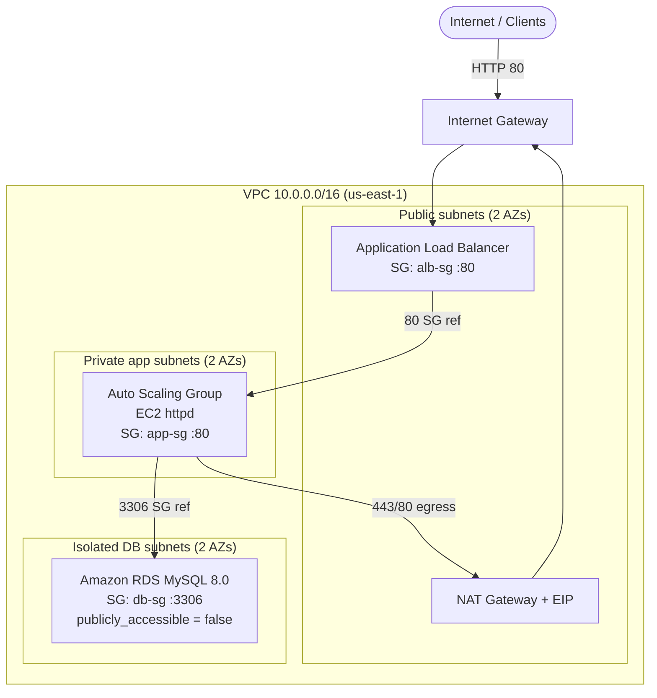

# Architecture Diagram

This diagram represents **exactly** what the Terraform code in `../terraform`
provisions. Every box maps to a real resource; every arrow maps to a real
Security Group or route table rule.

> Defaults shown: region `us-east-1`, VPC `10.0.0.0/16`, `az_count = 2`,
> `single_nat_gateway = true`.

---

## 1. High-level tier view

```
                                 ┌─────────────┐
                                 │   Internet  │
                                 │  (clients)  │
                                 └──────┬──────┘
                                        │ HTTP :80
                                        ▼
                            ╔═══════════════════════╗
                            ║  Internet Gateway     ║
                            ╚═══════════┬═══════════╝
                                        │
        ┌───────────────────────────────────────────────────────────┐
        │  WEB / LOAD-BALANCING TIER  (public subnets)                │
        │  Application Load Balancer (internet-facing)                │
        │  SG: alb-sg  (ingress 80 from allowed_web_cidr)             │
        └───────────────────────────────┬───────────────────────────┘
                                        │ HTTP :80  (SG ref: alb-sg ➜ app-sg)
                                        ▼
        ┌───────────────────────────────────────────────────────────┐
        │  APPLICATION TIER  (private subnets, no public IP)          │
        │  Auto Scaling Group of EC2 (Amazon Linux 2023 + httpd)      │
        │  SG: app-sg  (ingress 80 ONLY from alb-sg)                  │
        └───────────────────────────────┬───────────────────────────┘
                                        │ MySQL :3306 (SG ref: app-sg ➜ db-sg)
                                        ▼
        ┌───────────────────────────────────────────────────────────┐
        │  DATABASE TIER  (isolated subnets, NO internet route)       │
        │  Amazon RDS for MySQL 8.0 (publicly_accessible = false)     │
        │  SG: db-sg  (ingress 3306 ONLY from app-sg)                 │
        └───────────────────────────────────────────────────────────┘
```

---

## 2. Detailed VPC / Availability Zone view

```
AWS Region: us-east-1
│
└─ VPC  cloudsec-pbl-dev-vpc  (10.0.0.0/16)
   │
   ├─ Internet Gateway  cloudsec-pbl-dev-igw
   │
   ├────────────────────── Availability Zone A (us-east-1a) ──────────────────────┐
   │                                                                              │
   │   PUBLIC subnet 10.0.0.0/24                                                  │
   │     • ALB node (web tier)                                                    │
   │     • NAT Gateway  ── Elastic IP                                             │
   │     • Route table: public-rt  → 0.0.0.0/0 via IGW                            │
   │                                                                              │
   │   PRIVATE-APP subnet 10.0.10.0/24                                            │
   │     • EC2 app instance (ASG)                                                 │
   │     • Route table: app-rt-a   → 0.0.0.0/0 via NAT GW (outbound only)         │
   │                                                                              │
   │   ISOLATED-DB subnet 10.0.20.0/24                                            │
   │     • RDS primary                                                            │
   │     • Route table: db-rt      → local only (NO internet route)               │
   │                                                                              │
   ├────────────────────── Availability Zone B (us-east-1b) ──────────────────────┤
   │                                                                              │
   │   PUBLIC subnet 10.0.1.0/24                                                  │
   │     • ALB node (web tier)                                                    │
   │     • Route table: public-rt  → 0.0.0.0/0 via IGW                            │
   │                                                                              │
   │   PRIVATE-APP subnet 10.0.11.0/24                                            │
   │     • EC2 app instance (ASG)                                                 │
   │     • Route table: app-rt-b   → 0.0.0.0/0 via NAT GW (outbound only)         │
   │                                                                              │
   │   ISOLATED-DB subnet 10.0.21.0/24                                            │
   │     • RDS standby (only if db_multi_az = true)                               │
   │     • Route table: db-rt      → local only (NO internet route)               │
   │                                                                              │
   └──────────────────────────────────────────────────────────────────────────┘

   DB subnet group = { 10.0.20.0/24, 10.0.21.0/24 }  (isolated subnets only)
```

---

## 3. Security Group trust chain (least privilege)

```
   allowed_web_cidr (0.0.0.0/0)
        │  tcp/80
        ▼
   ┌──────────┐   tcp/80 (SG ref)   ┌──────────┐   tcp/3306 (SG ref)   ┌──────────┐
   │  alb-sg  │ ──────────────────▶ │  app-sg  │ ────────────────────▶ │  db-sg   │
   └──────────┘                     └──────────┘                       └──────────┘
                                         │  tcp/80,443 → 0.0.0.0/0
                                         ▼  (egress via NAT for patching only)
                                    Internet (outbound)
```

- `alb-sg` → `app-sg` and `app-sg` → `db-sg` use **security-group references**,
  not CIDR ranges, so rules stay correct regardless of IP layout.
- `db-sg` has **no** rule permitting the internet or any broad CIDR: the
  database cannot be reached publicly.

---

## 4. Direction of traffic (request path)

```
Client ─▶ IGW ─▶ ALB (:80, public subnet)
                   └─▶ App EC2 (:80, private subnet)
                         └─▶ RDS MySQL (:3306, isolated subnet)
                               └─▶ response back up the same path
```

Outbound-only path used for patching/secrets:

```
App EC2 ─▶ NAT Gateway (public subnet) ─▶ IGW ─▶ Internet   (updates, SSM, package repos)
RDS      ─╳ no internet route at all
```

---

## 5. Rendering this as an image (optional, for screenshots)

The ASCII diagram above is authoritative. To produce a polished PNG for the
report you can paste the following Mermaid into <https://mermaid.live> and
export an image into `../screenshots/`:


